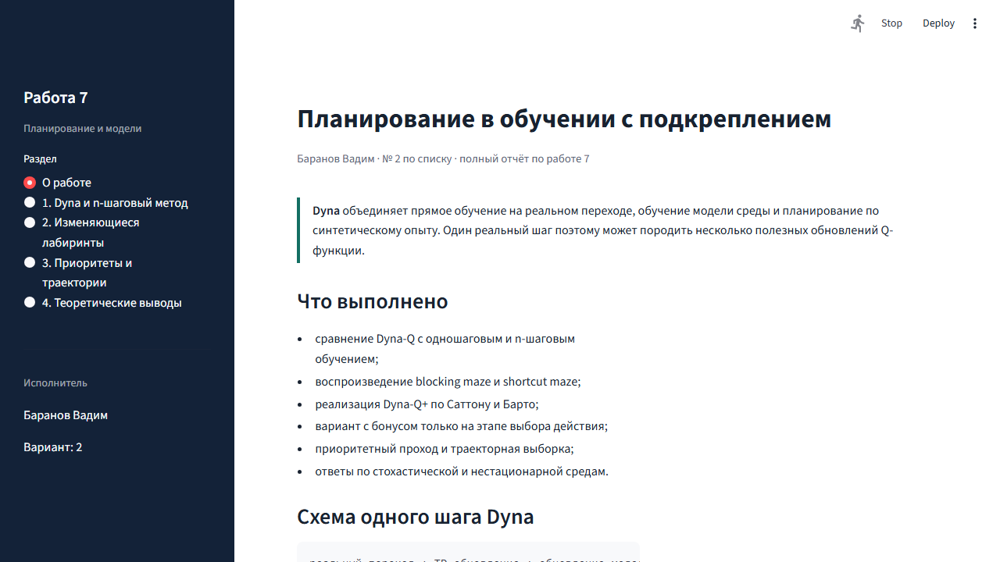

# 🧭 Лабораторная работа 1 · Планирование в RL

<div align="center">

**Dyna-Q · Dyna-Q+ · приоритетный проход · траекторная выборка · n-step SARSA**


</div>

## 📚 О работе

Самостоятельная реализация методов планирования в обучении с подкреплением. Основа работы — ноутбук методички `ЛР1_Планирование_7_1.ipynb`; эксперименты вынесены в модульный Python-код и интерактивное Streamlit-приложение.

> **Исполнитель:** Баранов Вадим, № 2 по списку.

## ✅ Реализовано

- Dyna-Q с одношаговым и n-шаговым обновлением;
- Dyna-Q+ с бонусом за исследование;
- приоритетный проход на основе TD-ошибки;
- планирование по траектории;
- сравнение выборочных и полных обновлений в стохастической среде;
- два сценария нестационарного лабиринта.

## 🖥️ Интерфейс



В приложении можно выбрать сценарий лабиринта, число шагов планирования и количество независимых запусков. Результаты отображаются в виде усреднённых кривых обучения с краткой интерпретацией.

## 🗂️ Структура проекта

| Файл | Назначение |
|---|---|
| `ЛР1_Планирование_7_1.ipynb` | Исходный учебный ноутбук |
| `algorithms.py` | Реализации алгоритмов и среды |
| `app.py` | Интерактивное Streamlit-приложение |
| `test_algorithms.py` | Автоматические проверки |
| `requirements.txt` | Зависимости проекта |

## 🚀 Запуск

```powershell
py -3.12 -m pip install -r requirements.txt
py -3.12 -m streamlit run app.py
```

Приложение откроется по адресу, который выведет Streamlit (обычно `http://localhost:8501`).

## 🧪 Проверка

```powershell
py -3.12 -m pytest -q
```

Локальная проверка выполнена успешно: **3 passed**. Эксперименты воспроизводимы: базовое зерно генератора равно номеру по списку — `2`.
